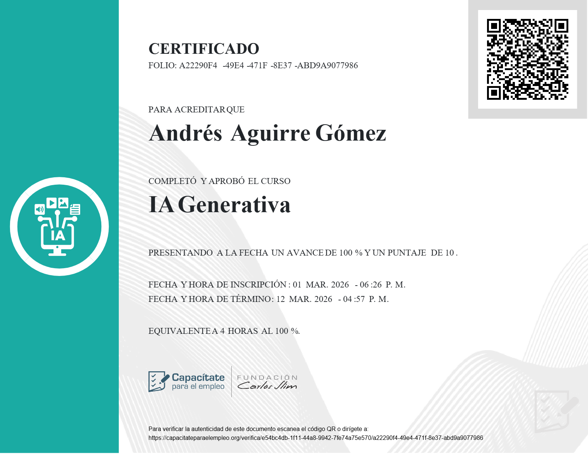

A lo largo de mi trayectoria he completado distintas certificaciones enfocadas en análisis de datos, machine learning y desarrollo. Aquí tienes las credenciales verificables.

::: {.grid}

::: {.g-col-12 .g-col-md-6 .g-col-lg-4}
::: {.cert-card onclick="verCertificado(0)"}

### Introducción a la Ciencia de Datos
:::
:::

::: {.g-col-12 .g-col-md-6 .g-col-lg-4}
::: {.cert-card onclick="verCertificado(1)"}

### Curador de datos
:::
:::

::: {.g-col-12 .g-col-md-6 .g-col-lg-4}
::: {.cert-card onclick="verCertificado(2)"}

### Finder
:::
:::

::: {.g-col-12 .g-col-md-6 .g-col-lg-4}
::: {.cert-card onclick="verCertificado(3)"}

### Fundamentos de inteligencia artificial
:::
:::

::: {.g-col-12 .g-col-md-6 .g-col-lg-4}
::: {.cert-card onclick="verCertificado(4)"}

### IA Generativa
:::
:::

::: {.g-col-12 .g-col-md-6 .g-col-lg-4}
::: {.cert-card onclick="verCertificado(5)"}

### Programador (orientado a objetos)
:::
:::

::: {.g-col-12 .g-col-md-6 .g-col-lg-4}
::: {.cert-card onclick="verCertificado(6)"}

### Safe, Fair and Legal AI use
:::
:::

::: {.g-col-12 .g-col-md-6 .g-col-lg-4}
::: {.cert-card onclick="verCertificado(7)"}

### Understanding machine learning
:::
:::

:::

<!-- Visor Modal Nativo (sin dependencias externas) -->

  <button type="button" onclick="cerrarCertificado()" aria-label="Cerrar" style="position:absolute; top:20px; right:28px; background:none; border:none; color:#fff; font-size:2.4rem; cursor:pointer; line-height:1;">&times;</button>
  
  <button type="button" onclick="cambiarCertificado(-1)" aria-label="Anterior" style="position:absolute; left:20px; top:50%; transform:translateY(-50%); background:rgba(255,255,255,0.12); border:none; color:#fff; font-size:2.2rem; width:50px; height:50px; border-radius:50%; cursor:pointer; display:flex; align-items:center; justify-content:center;">&#10094;</button>
  
  
  

  
  <button type="button" onclick="cambiarCertificado(1)" aria-label="Siguiente" style="position:absolute; right:20px; top:50%; transform:translateY(-50%); background:rgba(255,255,255,0.12); border:none; color:#fff; font-size:2.2rem; width:50px; height:50px; border-radius:50%; cursor:pointer; display:flex; align-items:center; justify-content:center;">&#10095;</button>

