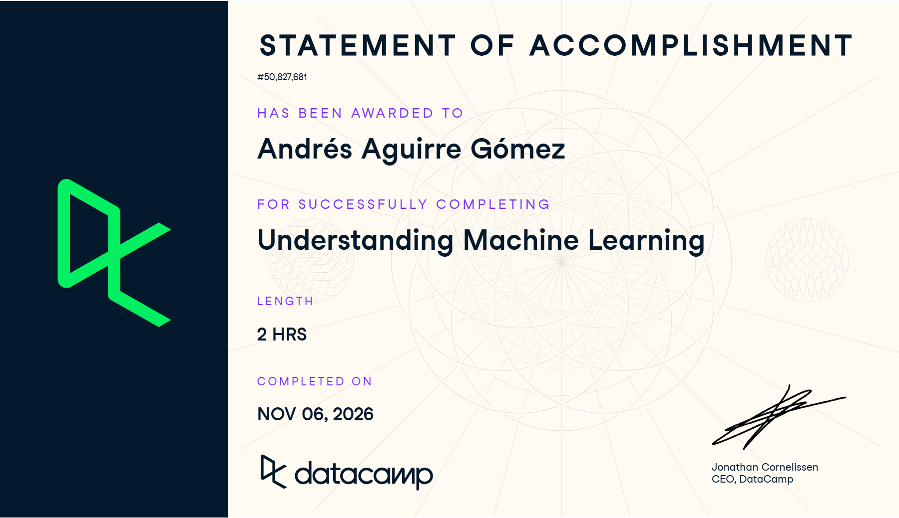

A lo largo de mi trayectoria he completado distintas certificaciones enfocadas en análisis de datos, machine learning y desarrollo. Aquí tienes las credenciales verificables.

::: {.grid}

::: {.g-col-12 .g-col-md-6 .g-col-lg-4}
::: {.cert-card}

### Introducción a la Ciencia de Datos
:::
:::

::: {.g-col-12 .g-col-md-6 .g-col-lg-4}
::: {.cert-card}

### Curador de datos
:::
:::

::: {.g-col-12 .g-col-md-6 .g-col-lg-4}
::: {.cert-card}

### Finder
:::
:::

::: {.g-col-12 .g-col-md-6 .g-col-lg-4}
::: {.cert-card}

### Fundamentos de inteligencia artificial
:::
:::

::: {.g-col-12 .g-col-md-6 .g-col-lg-4}
::: {.cert-card}

### IA Generativa
:::
:::

::: {.g-col-12 .g-col-md-6 .g-col-lg-4}
::: {.cert-card}

### Programador (orientado a objetos)
:::
:::

::: {.g-col-12 .g-col-md-6 .g-col-lg-4}
::: {.cert-card}

### Safe, Fair and Legal AI use
:::
:::

::: {.g-col-12 .g-col-md-6 .g-col-lg-4}
::: {.cert-card}

### Understanding machine learning
:::
:::

:::