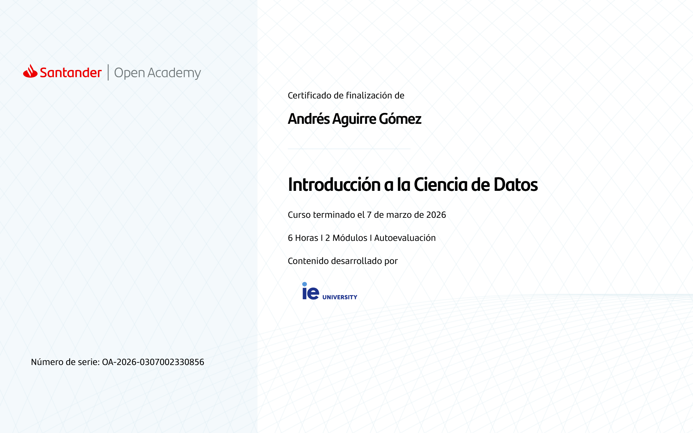
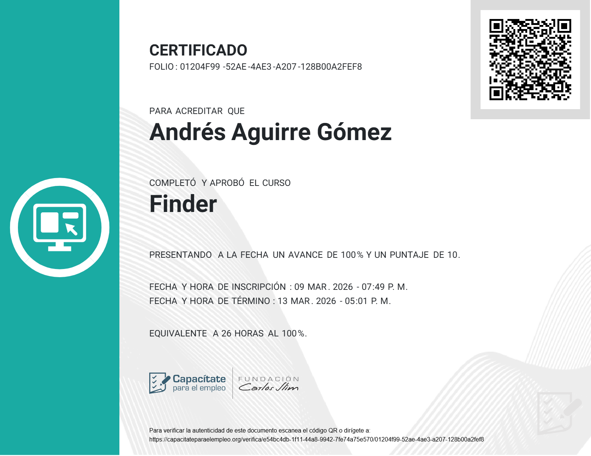
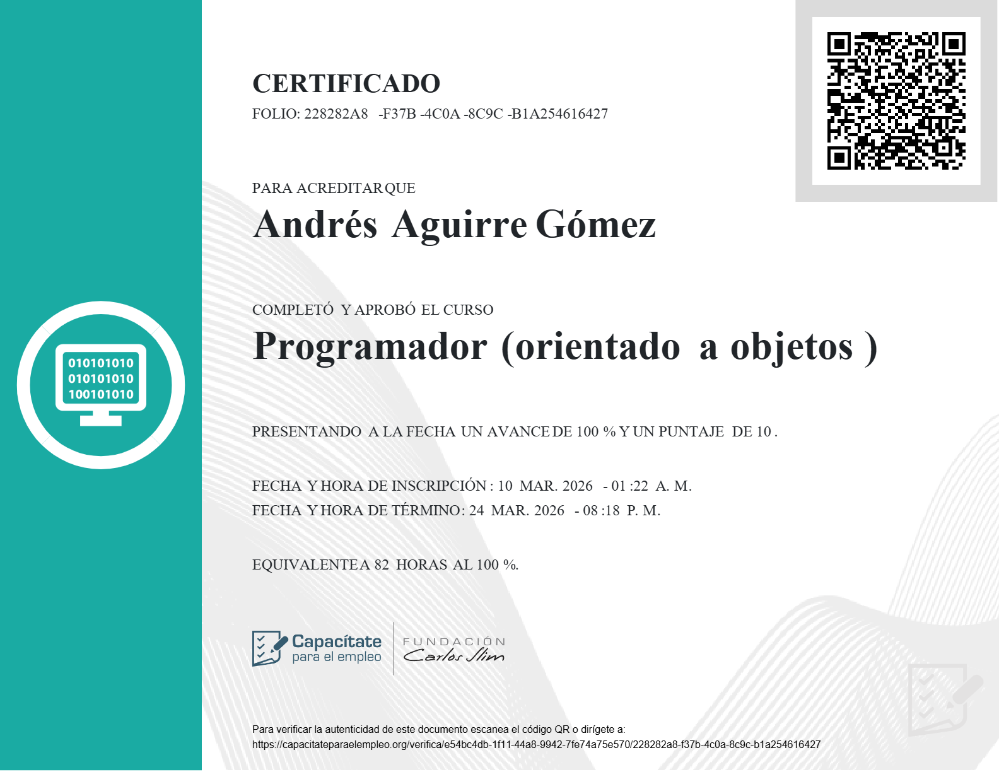

A lo largo de mi trayectoria he completado distintas certificaciones enfocadas en análisis de datos, machine learning y desarrollo. Aquí tienes las credenciales verificables.

::: {.grid}

::: {.g-col-12 .g-col-md-6 .g-col-lg-4}
::: {.cert-card}
[{.cert-thumb}](./images/certificados/intro-ds.png)
### Introducción a la Ciencia de Datos
**TripleTen**
[Ver PDF original →](./certificados/Cert-Introducción%20a%20la%20Ciencia%20de%20Datos.pdf){.btn .btn-sm .btn-primary target="_blank"}
:::
:::

::: {.g-col-12 .g-col-md-6 .g-col-lg-4}
::: {.cert-card}
[{.cert-thumb}](./images/certificados/curador-datos.png)
### Curador de datos
**TripleTen**
[Ver PDF original →](./certificados/Curador%20de%20datos.pdf){.btn .btn-sm .btn-primary target="_blank"}
:::
:::

::: {.g-col-12 .g-col-md-6 .g-col-lg-4}
::: {.cert-card}
[{.cert-thumb}](./images/certificados/finder.png)
### Finder
**TripleTen**
[Ver PDF original →](./certificados/Finder.pdf){.btn .btn-sm .btn-primary target="_blank"}
:::
:::

::: {.g-col-12 .g-col-md-6 .g-col-lg-4}
::: {.cert-card}
[{.cert-thumb}](./images/certificados/ia-fundamentos.png)
### Fundamentos de inteligencia artificial
**TripleTen**
[Ver PDF original →](./certificados/Fundamentos%20de%20inteligencia%20artificial.pdf){.btn .btn-sm .btn-primary target="_blank"}
:::
:::

::: {.g-col-12 .g-col-md-6 .g-col-lg-4}
::: {.cert-card}
[{.cert-thumb}](./images/certificados/ia-generativa.png)
### IA Generativa
**TripleTen**
[Ver PDF original →](./certificados/IA%20Generativa.pdf){.btn .btn-sm .btn-primary target="_blank"}
:::
:::

::: {.g-col-12 .g-col-md-6 .g-col-lg-4}
::: {.cert-card}
[{.cert-thumb}](./images/certificados/poo.png)
### Programador (orientado a objetos)
**TripleTen**
[Ver PDF original →](./certificados/Programador%20(orientado%20a%20objetos).pdf){.btn .btn-sm .btn-primary target="_blank"}
:::
:::

::: {.g-col-12 .g-col-md-6 .g-col-lg-4}
::: {.cert-card}
[{.cert-thumb}](./images/certificados/safe-ai.png)
### Safe, Fair and Legal AI use
**TripleTen**
[Ver PDF original →](./certificados/Safe,%20Fair%20and%20Legal%20AI%20use%20certificado.pdf){.btn .btn-sm .btn-primary target="_blank"}
:::
:::

::: {.g-col-12 .g-col-md-6 .g-col-lg-4}
::: {.cert-card}
[{.cert-thumb}](./images/certificados/understanding-ml.png)
### Understanding machine learning
**TripleTen**
[Ver PDF original →](./certificados/Understanding%20machine%20learning.pdf){.btn .btn-sm .btn-primary target="_blank"}
:::
:::

:::